  

# 📱 Awesome Mobile Visual Regression Testing 🚀

  
  
  
  
  
  

> 🌟 **A curated list of top Mobile Visual Regression Testing platforms, frameworks, and snapshot tools** — featuring commercial enterprise SaaS clouds and open-source alternatives for catching unintended UI regressions, layout bugs, font shifts, and visual anomalies across native Android and iOS applications.
>
> 🎯 *Star this repository to keep track of cutting-edge mobile automated UI testing tooling!* ⭐️

---

## 📑 Table of Contents

- [📈 Sector Overview & Market Dynamics](#-sector-overview--market-dynamics)
- [🟦 SaaS / Hosted Platforms](#-saas--hosted-platforms)
- [🟩 Open-Source Software](#-open-source-software)
- [📊 Comparison at a Glance](#-comparison-at-a-glance)
- [💡 Best Practices for Mobile Visual Testing](#-best-practices-for-mobile-visual-testing)
- [⭐ Star History](#-star-history)
- [💖 Support & Sponsorship](#-support--sponsorship)
- [🤝 Contributing](#-contributing)
- [📄 License](#-license)

---

## 📈 Sector Overview & Market Dynamics

The global mobile application testing market is valued at approximately **$8B to $11.5B** and is projected to expand at a compound annual growth rate (**CAGR of 13%–17%**), surpassing $30B+ over the next decade. Automated visual regression and screenshot testing represent the highest-demand tier within continuous integration and delivery (CI/CD) pipelines.

The sector is **moderately fragmented**: although continuous testing giants (e.g., BrowserStack, Sauce Labs) and enterprise testing services dominate high-volume device cloud infrastructure, extreme OS, viewport, and hardware fragmentation across native Android and iOS ecosystems prevents a winner-take-all monopoly. This dynamic fosters specialized, niche visual AI engines alongside thriving developer-centric open-source snapshot libraries that run directly on local JVMs or in-process XCTest harnesses.

---

## 🟦 SaaS / Hosted Platforms

Commercial, cloud-hosted Mobile Visual Regression Testing platforms sorted by company size (**valuation / revenue descending**):

| Platform | Company Valuation / Revenue | Starting Pricing Tier | Free Tier / Trial Limits | Mobile Testing Support | Best For |
|---|---|---|---|---|---|
| **[BrowserStack Percy](https://percy.io/)** | **$4B Valuation** (~$230M ARR) | **$199/month** (Desktop, billed annually) or **$599/month** (Desktop & Mobile, billed annually; $0.048/overage snapshot) | **Free Forever Plan**: 5,000 screenshots/month, unlimited users & projects | Native iOS & Android via Appium / Percy CLI + Real mobile browsers | Managed visual review across web and native mobile with transparent per-screenshot pricing and strong CI/CD integration |
| **[Sauce Labs Visual](https://saucelabs.com/)** | **$613M Valuation** (~$65M–$92M ARR) | **$199/month** (billed annually, includes real device/virtual device cloud concurrency + baseline snapshot allowance) | **28-Day Free Trial**: 60 automated & live testing minutes across 3 parallel VMs with real mobile devices & emulators | Real device cloud + iOS Simulators / Android Emulators | Teams already embedded in Sauce Labs' cross-browser/device cloud wanting consolidated visual regression |
| **[LambdaTest SmartUI](https://www.lambdatest.com/smart-ui)** | **$400M Valuation** (~$19M ARR) | **$199/month** (billed annually for 15,000 screenshots/month) | **Free Forever Plan**: 2,000 lifetime screenshots with responsive visual engine & build history | Real mobile device cloud + Playwright/Appium/Storybook integrations | Cross-browser and mobile cloud testing teams looking for bundled Storybook & Figma visual diffing |
| **[Applitools Eyes](https://applitools.com/)** | **~$250M–$300M Valuation** (Acquired by Thoma Bravo; ~$30M–$100M ARR) | **$667/month** (Starter tier billed annually at $8,004/year for up to 1,000 page checkpoints or 100,000 component checkpoints/month) | **14-Day Free Trial**: Full-featured access to Visual AI engine and test unit checkpoint allocations | Native Android & iOS apps via Appium / Espresso / XCUITest SDKs | Enterprises demanding highest-accuracy Visual AI with minimal false positives and layout-aware diffing |

---

## 🟩 Open-Source Software

Self-hosted, community-driven Mobile Visual Regression and Screenshot Testing tools, sorted by **GitHub stargazers (descending)**:

### 1. [pointfreeco/swift-snapshot-testing](https://github.com/pointfreeco/swift-snapshot-testing) 
- 🛠️ **Stack:** Swift / XCTest | ⚖️ **License:** MIT | 📱 **Platform:** iOS, macOS, tvOS, watchOS
- 📖 Delightful, industry-standard Swift snapshot testing library that lets you record and verify snapshots of `UIView`, `UIViewController`, SwiftUI views, layers, and arbitrary data types directly within XCTest without third-party cloud dependencies.
- 🎯 **Best for:** Native iOS and Swift developers who want deterministic snapshot assertions within standard unit and integration tests.

### 2. [cashapp/paparazzi](https://github.com/cashapp/paparazzi) 
- 🛠️ **Stack:** Kotlin / JVM / layoutlib | ⚖️ **License:** Apache-2.0 | 📱 **Platform:** Android (Jetpack Compose & Views)
- 📖 Render Android screens and Jetpack Compose composables directly on the JVM without needing a physical device or emulator. By utilizing Android's layoutlib, it renders deterministic screenshots in seconds on CI runners.
- 🎯 **Best for:** Android engineering teams wanting lightning-fast visual regression checks for Jetpack Compose and XML layouts without emulator overhead.

### 3. [uber/ios-snapshot-test-case](https://github.com/uber/ios-snapshot-test-case) 
- 🛠️ **Stack:** Objective-C / Swift | ⚖️ **License:** MIT | 📱 **Platform:** iOS
- 📖 Originally created by Facebook as `FBSnapshotTestCase` and maintained by Uber, this foundational framework takes configured `UIView` or `CALayer` instances, renders them to images, and compares them against reference baseline images pixel-by-pixel.
- 🎯 **Best for:** Established iOS applications with legacy Objective-C or Swift codebases needing reliable, view-based reference assertions.

### 4. [facebookarchive/screenshot-tests-for-android](https://github.com/facebookarchive/screenshot-tests-for-android) 
- 🛠️ **Stack:** Java / Python / Gradle | ⚖️ **License:** Apache-2.0 | 📱 **Platform:** Android
- 📖 Deterministic instrumentation screenshot testing library developed by Meta/Facebook. It runs layouts on the instrumentation thread without animation or rendering flakiness, providing clean diffing for Android views.
- 🎯 **Best for:** Traditional Android instrumentation test suites requiring deterministic screenshot capture on Android emulators or devices.

### 5. [reg-viz/reg-suit](https://github.com/reg-viz/reg-suit) 
- 🛠️ **Stack:** Node.js / CLI | ⚖️ **License:** MIT | 📱 **Platform:** Framework-agnostic (Ingests image directories)
- 📖 Flexible CLI visual regression testing tool with a plugin ecosystem. It compares images against previous baselines stored in cloud storage (AWS S3, Google Cloud Storage), generates responsive HTML visual diff reports, and posts pull request comments across GitHub, GitLab, and Slack.
- 🎯 **Best for:** Teams looking for a lightweight, plugin-driven CLI that integrates with any mobile screenshot capture pipeline (Appium, Maestro, Espresso).

### 6. [pedrovgs/Shot](https://github.com/pedrovgs/Shot) 
- 🛠️ **Stack:** Kotlin / Android Gradle Plugin | ⚖️ **License:** Apache-2.0 | 📱 **Platform:** Android (Compose & Views)
- 📖 Shot is a developer-friendly Android Gradle plugin that facilitates screenshot testing for Android apps. It integrates seamlessly with Jetpack Compose previews and Espresso tests, generating HTML diff reports upon failure.
- 🎯 **Best for:** Android developers wanting zero-configuration Gradle integration for Compose and Espresso screenshot testing with automated report generation.

### 7. [takahirom/roborazzi](https://github.com/takahirom/roborazzi) 
- 🛠️ **Stack:** Kotlin / JVM / Robolectric | ⚖️ **License:** Apache-2.0 | 📱 **Platform:** Android (Compose & Views)
- 📖 Modern Android screenshot testing library powered by Robolectric Native Graphics. It captures screenshots of Jetpack Compose composables and standard Android views on the JVM, supporting GIF output for animations, AI image comparison, and seamless CI verification.
- 🎯 **Best for:** Teams using Robolectric for Android unit tests who want fast JVM-based screenshot regression verification with rich diffing and animation support.

### 8. [Visual-Regression-Tracker/Visual-Regression-Tracker](https://github.com/Visual-Regression-Tracker/Visual-Regression-Tracker) 
- 🛠️ **Stack:** TypeScript / Node.js / PostgreSQL / Docker | ⚖️ **License:** MIT | 📱 **Platform:** Framework-agnostic (Web, Mobile, Desktop)
- 📖 An enterprise-grade, self-hosted open-source platform for tracking and approving visual regressions. Accepts screenshots from Appium, Espresso, XCUITest, or Playwright. Offers multiple comparison engines: Pixelmatch, Looks-Same, Odiff, and Vision Language Model (VLM) for AI-driven noticeability checks.
- 🎯 **Best for:** Teams needing a complete self-hosted alternative to Percy or Applitools with a multi-tenant review dashboard, baseline history, and ignore regions.

### 9. [argos-ci/argos](https://github.com/argos-ci/argos) 
- 🛠️ **Stack:** TypeScript / Node.js | ⚖️ **License:** MIT | 📱 **Platform:** Framework-agnostic (Web & Mobile screenshots)
- 📖 An open-source visual testing and review platform tailored for teams and AI agents. Ingests screenshots from mobile CI pipelines, provides GitHub PR integration, and flags visual changes with interactive diffing.
- 🎯 **Best for:** Modern software engineering teams wanting an MIT-licensed, developer-first visual review interface with active agentic and CI integrations.

### 10. [carbonmeai/danwo](https://github.com/carbonmeai/danwo) 
- 🛠️ **Stack:** TypeScript / Node.js | ⚖️ **License:** Apache-2.0 | 📱 **Platform:** Android Emulator & iOS Simulator
- 📖 Agentic end-to-end testing framework for web and mobile applications with built-in screenshot assertions (`toHaveScreenshot`). Includes network egress emulation and a fault matrix engine to test mobile apps against edge cases (HTTP 429/500, clock drifts, network drops).
- 🎯 **Best for:** Teams wanting an end-to-end test runner with built-in visual screenshot assertions and resilience/fault simulation.

### 11. [yewohq/yewo](https://github.com/yewohq/yewo) 
- 🛠️ **Stack:** Python / Node.js / Appium | ⚖️ **License:** Apache-2.0 | 📱 **Platform:** Native iOS & Android
- 📖 An AI-powered autonomous testing agent for mobile apps that uses vision models to locate controls directly from screen captures rather than brittle accessibility or test IDs, generating visual anomaly evidence.
- 🎯 **Best for:** Exploratory autonomous mobile testing and visual anomaly detection without writing manual selector scripts.

---

## 📊 Comparison at a Glance

| Tool / Platform | Category | Primary License | Platform / Ecosystem | Execution / Engine | Self-Hosted | Free Option |
|---|---|---|---|---|---|---|
| **BrowserStack Percy** | Commercial SaaS | Proprietary | Web, iOS & Android | Cloud Snapshot + Pixel Diff | ❌ | ✅ Free tier (5,000 screenshots/mo) |
| **Sauce Labs Visual** | Commercial SaaS | Proprietary | Real Mobile & Emulators | Cloud Smart Hybrid Diff | ❌ | ⚠️ 28-day free trial |
| **LambdaTest SmartUI** | Commercial SaaS | Proprietary | Web, iOS & Android | Cloud Visual AI Engine | ❌ | ✅ Free tier (2,000 lifetime screenshots) |
| **Applitools Eyes** | Commercial SaaS | Proprietary | Web, iOS & Android | Cloud Visual AI Engine | ❌ | ⚠️ 14-day free trial |
| **swift-snapshot-testing** | Open Source | MIT | Native iOS / Swift | Local XCTest In-Process | ✅ | ✅ Completely Free |
| **Paparazzi** | Open Source | Apache-2.0 | Android (Compose & Views) | JVM / layoutlib | ✅ | ✅ Completely Free |
| **ios-snapshot-test-case** | Open Source | MIT | Native iOS / Objective-C & Swift | Local XCTest In-Process | ✅ | ✅ Completely Free |
| **screenshot-tests-for-android** | Open Source | Apache-2.0 | Android | Instrumentation on device/emulator | ✅ | ✅ Completely Free |
| **reg-suit** | Open Source | MIT | Framework-agnostic CLI | CLI Pixel Diff + Cloud Storage | ✅ | ✅ Completely Free |
| **Shot** | Open Source | Apache-2.0 | Android (Compose & Views) | Gradle Plugin / Instrumentation | ✅ | ✅ Completely Free |
| **Roborazzi** | Open Source | Apache-2.0 | Android (Compose & Views) | JVM / Robolectric Native Graphics | ✅ | ✅ Completely Free |
| **Visual Regression Tracker** | Open Source | MIT | Framework-agnostic Platform | Docker Server / Multi-Engine (VLM/Pixelmatch) | ✅ | ✅ Completely Free |
| **Argos** | Open Source | MIT | Framework-agnostic Platform | Docker / Cloud Review UI | ✅ | ✅ Completely Free |
| **dánwò** | Open Source | Apache-2.0 | Web & Mobile Simulators | Agentic E2E + Built-in Screenshot | ✅ | ✅ Completely Free |
| **Yewo** | Open Source | Apache-2.0 | Native iOS & Android | Vision Model + Appium Agent | ✅ | ✅ Completely Free |

---

## 💡 Best Practices for Mobile Visual Testing

- 🕒 **Disable Dynamic Animations & Timers**: Ensure animations, blinking cursors, and progress spinners are disabled or zeroed out during capture runs.
- 📱 **Pin Viewport & Device Density**: Keep simulator/emulator screen resolutions, scale factors, and OS versions strictly fixed across local machines and CI agents.
- 🔤 **Mock Dynamic Text & Timestamps**: Freeze mock system clocks, localized text strings, and network payloads to prevent flaky false-positive diff alerts.
- 🧩 **Prefer JVM & In-Process Tests where Possible**: For Android Jetpack Compose (using Paparazzi or Roborazzi) and iOS SwiftUI (using swift-snapshot-testing), run snapshot checks directly in unit test phases before spinning up heavy device clouds.

---

## ⭐ Star History

---

## 💖 Support & Sponsorship

Thank you so much for exploring this curated collection of mobile visual regression testing tools! Maintaining and updating these resources takes time and passion.

If this repository helped you discover the right tool, improve your testing pipeline, or save engineering hours, please consider showing your support:

- ⭐️ **Star** this repository to increase visibility and help other mobile developers find it.
- 🍴 **Fork** and share it with your engineering team or community.
- ☕ **Sponsor or Buy a Coffee**: Support ongoing open-source curation and tool evaluation via the [GitHub Sponsors Dashboard](https://github.com/sponsors/ishandutta2007).

Your backing and feedback are deeply appreciated! 🙏

---

## 🤝 Contributing

Contributions are warmly welcome! If you know of an open-source or commercial Mobile Visual Regression Testing tool that should be featured:

1. Fork this repository.
2. Create a new branch: `git checkout -b feature/add-new-tool`.
3. Add the project with details (Name, URL, Stack, License, Key strengths).
4. Submit a Pull Request with a clear description.

Please ensure that open-source submissions are actively maintained and genuinely open-source.

---

## 📄 License

This collection is released under the [Creative Commons Zero v1.0 Universal](LICENSE) (CC0 1.0 Universal - Public Domain Dedication). All referenced trademarks and project names belong to their respective owners.

---

  <b>⭐ If this guide proved valuable, don't forget to star the repository! ⭐</b>

